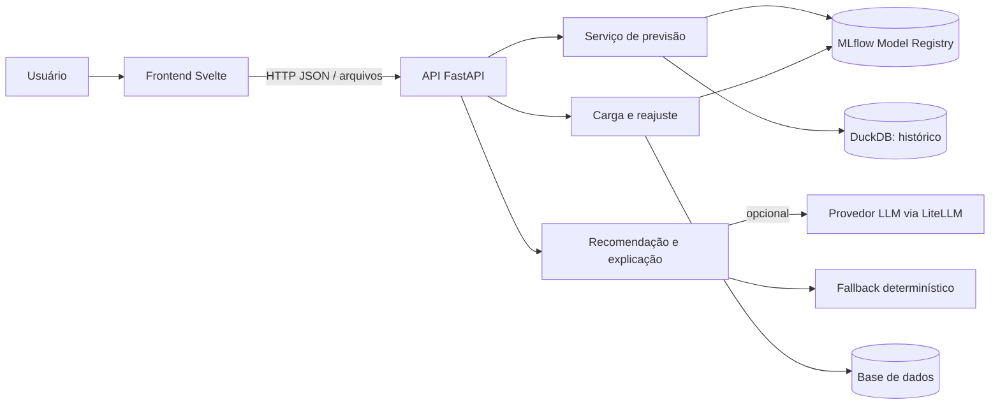

# Visão geral

A interface Svelte consome a API FastAPI. A API valida contratos e coordena serviços de previsão, recomendação, carga e reajuste. MLflow guarda modelos versionados e DuckDB mantém histórico de previsões. Integrações de linguagem usam LiteLLM com fallback determinístico; a chave do provedor é configurada no ambiente e não deve ser enviada ao navegador.

A API é a fronteira entre navegador e serviços Python. Use `/docs` para os contratos atuais; esta documentação não mantém uma tabela paralela de endpoints. Os módulos estão em `frontend/src/` e `src/case_mr_health/api/`. O registro e o histórico seguem [ADR 0005](../decisoes/adr/0005-registry-mlflow-e-historico-em-duckdb.md); a atualização de dados e reajuste segue [ADR 0011](../decisoes/adr/0011-atualizacao-de-dados-pela-api-com-reajuste.md).
