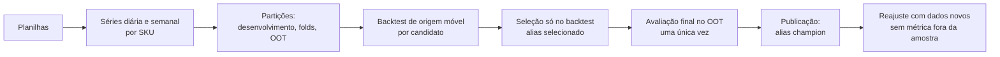

# Ciência de dados

Esta seção descreve como o modelo de demanda é construído, validado e servido. O texto é conceitual (o que cada etapa assume e por que), mas cada afirmação aponta para uma fonte: arquivo e linha do código, ADR ou relatório de fase. Onde não há fonte, a frase vem marcada como **hipótese**.

## Convenções desta seção

- **Evidência** é o que foi lido no código, no registro MLflow ou em um relatório, com o localizador ao lado. **Hipótese** é o que não foi verificado e não deve ser lido como fato.
- Números de métricas são **citados** dos relatórios, não recalculados. A fonte de cada um está na tabela ou na frase.
- Localizadores `arquivo.py:N` são do código em `src/case_mr_health/` no commit desta documentação. Se o arquivo mudar, a linha pode se deslocar; o nome da função continua valendo.
- Os ADRs estão na seção [Decisões](../decisoes/index.md).

## Visão em uma página

| Página | Conteúdo |
| --- | --- |
| [Dados e partições](dados-e-particoes.md) | Séries, zero imputado, semana, partições e OOT |
| [Candidatos e backtest](candidatos-e-backtest.md) | Candidatos, hiperparâmetros, origem móvel e métricas |
| [Seleção e intervalos](selecao-e-intervalos.md) | Regra de seleção, intervalos empíricos e a confiança removida |
| [Reajuste e avaliação final](reajuste-e-avaliacao.md) | Reajuste, avaliação no OOT, reavaliação de demonstração e a premissa de um modelo por série |

## Limitações que valem para tudo

Elas condicionam a leitura de qualquer número desta seção.

1. **Histórico curto.** A base cobre 2021-06-01 a 2021-09-01, cerca de 3 meses completos por SKU (ADR 0001). Por isso não há modelo mensal e as séries semanais têm poucos pontos (12 semanas por SKU: parâmetro `n_observacoes` das versões 6 das semanais no MLflow).
2. **Venda como proxy da demanda.** O modelo prevê a quantidade vendida. Venda não é demanda: dias sem venda podem refletir falta de estoque ou de pedido, e o projeto não tem dado de estoque (`explicacao.py:94`, comentário "Sem dado de estoque no projeto"). **Hipótese**: parte dos zeros é demanda não atendida; não foi verificado.
3. **OOT pequeno.** O OOT semanal tem 2 pontos e o diário, 14, autocorrelacionados (ADR 0002; `docs/relatorio/fase4/13-avaliacao-final.md`, seção Limitações).
4. **Versões reajustadas sem métrica fora da amostra.** As versões que hoje respondem pelo alias `champion` foram reajustadas depois da avaliação final (reajuste #40 de 2026-10-30, versões 19 nas diárias e 6 nas semanais); backtest e OOT descrevem a versão original (ADR 0011).
5. **A avaliação cega foi consumida uma vez.** Qualquer nova leitura do OOT é uma reavaliação de demonstração, não estimativa independente (ADR 0012).

!!! warning "Como ler os resultados"
    Com 3 meses de dados, as diferenças entre candidatos são pequenas frente à variação entre folds. O projeto adota freios (ver [Seleção](selecao-e-intervalos.md)), mas nenhum deles transforma esta amostra em prova de superioridade.

## O que não foi consultado

Para esta seção não foram lidos: os notebooks (`notebooks/`, EDA e validação da confiança), `docs/analysis/plano-candidatos.md`, `plano-intervalos.md` e `protocolo-avaliacao-final.md` (apenas citados pelo código e pelos ADRs), os pré-registros `docs/relatorio/fase2/*-pre-registro.md`, as planilhas brutas e o conteúdo de `.ds-workflow/`. As afirmações que dependem deles vêm atribuídas ao ADR ou ao comentário do código que os resume. Nenhum treino, reajuste ou chamada à API foi executado; o registro MLflow foi lido só em modo leitura.
